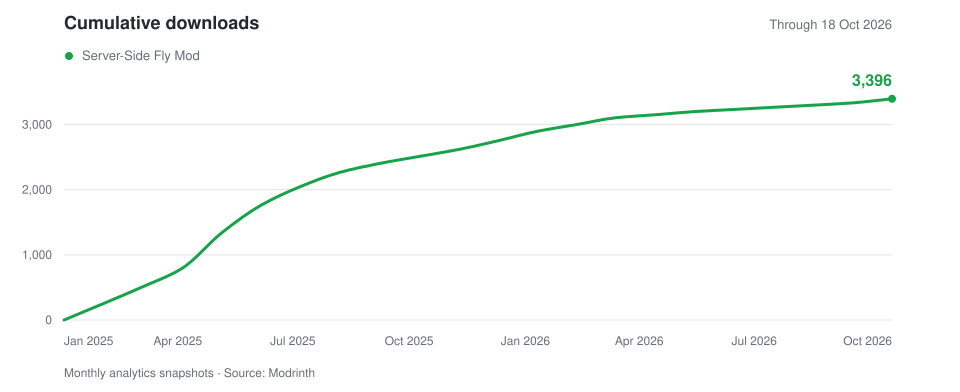

# Server-side Fly Mod 
https://modrinth.com/mod/fly-mod

Fabric mod for **Minecraft 26.3**. Install on the server; vanilla clients supported.
Requires Java 25+, Fabric Loader 0.19.5+, and Fabric API 0.163.0+26.3.

## Downloads since release

Monthly download history from [Modrinth](https://modrinth.com/mod/fly-mod), shown cumulatively. Snapshot: 18 October 2026.

## Commands

Flight is available to everyone by default. Each player's toggle is independent.

| Command | Action | Access |
| --- | --- | --- |
| `/fly` | Toggle your flight | Players |
| `/fly <speed>` | Set speed from 0.1–100; `1` = normal | Players with flight enabled |
| `/fly operatorsOnly` | Show the access setting | Operators / console |
| `/fly operatorsOnly true` | Restrict flight to operators | Operators / console |
| `/fly operatorsOnly false` | Allow everyone to fly | Operators / console |

Operators need permission level 2+. The access setting persists in `config/flymod.properties`.

Build and run regression tests: `./gradlew build`.
Install `build/libs/flymod-2.0.0+26.3.jar`.

Test in a local world: `./gradlew runClient`.
